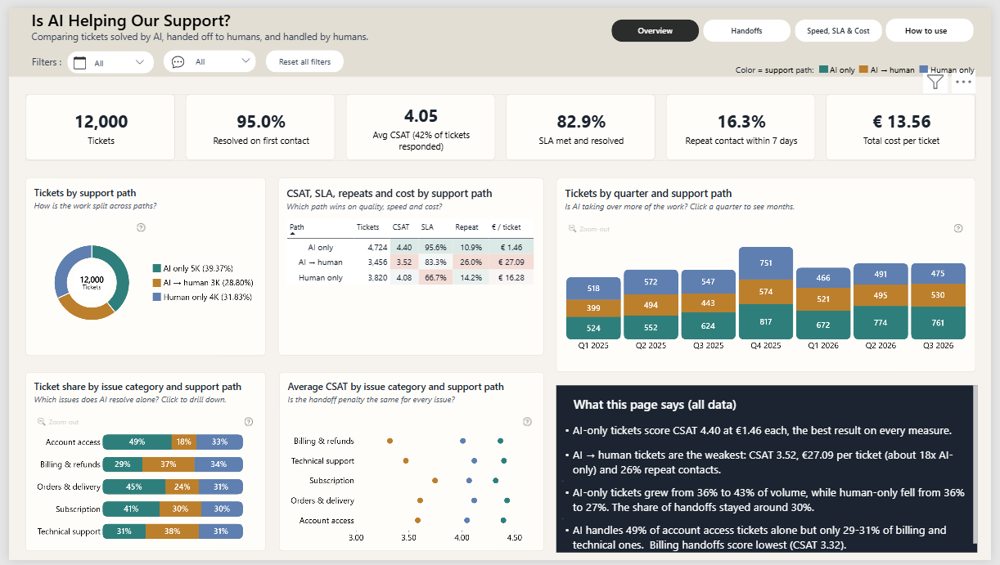
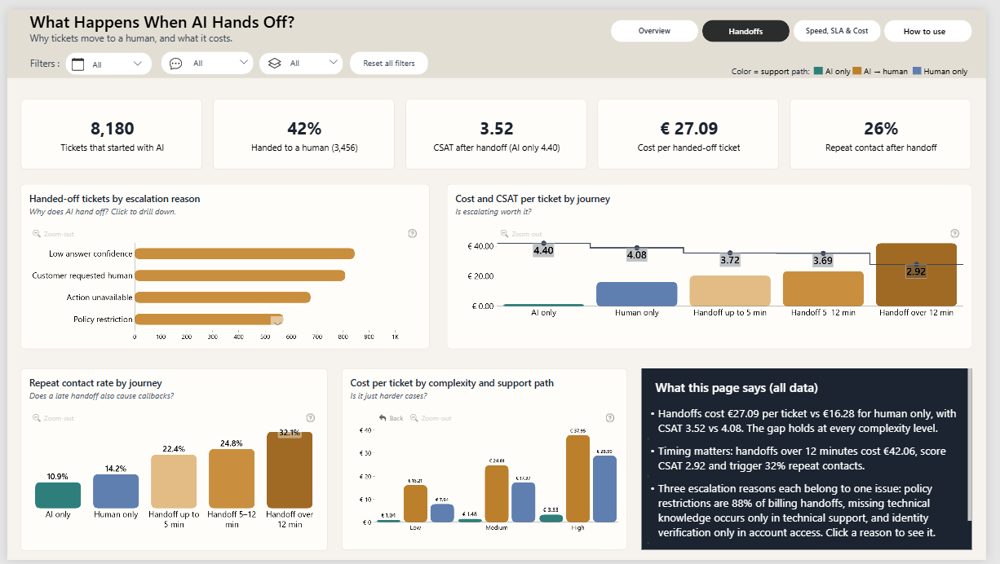
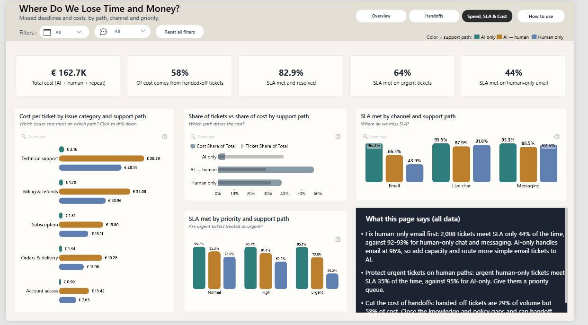

# powerbi-ai-agents-customer-support-analytics
An interactive Power BI report that asks one question: **is AI actually helping customer support, or just passing the problem to a human?**

Built for the [FP20 Analytics x ZoomCharts Challenge 42](https://zoomcharts.com/en/microsoft-power-bi-custom-visuals/challenges/fp20-analytics-challenge-42).

🔗 [Publish to Web link](ADD_LINK_HERE) · [LinkedIn post](ADD_LINK_HERE)

## The report





## What I looked at
12,000 customer support tickets (Jan 2025 to Sep 2026) from a fictional European software and smart-home company. Every ticket follows one of three paths, and the report compares them throughout, using the same colours on every page:

- **AI only:** the AI resolves the ticket alone
- **AI → human:** the AI starts, then hands off to a person
- **Human only:** a person handles it from the start

## Pages
1. **Overview:** compares the three paths on CSAT, SLA, repeat contacts and cost, and shows which issue types AI can resolve alone.
2. **Handoffs:** why AI hands tickets to humans, what late handoffs cost, and whether harder cases explain it.
3. **Speed, SLA & Cost:** where deadlines are missed, where the money goes, and three recommended fixes.


## Key findings
- AI-only tickets score CSAT **4.40** at **€1.46** each. AI → human tickets score **3.52** at **€27.09**.
- Handed-off tickets are **29% of volume but 58% of the cost**.
- Handoffs over 12 minutes cost **€42.06**, score CSAT **2.92** and trigger **32%** repeat contacts.
- The handoff penalty holds at every complexity level, so harder cases alone don't explain it.
- Human-only email meets SLA only **44%** of the time. Urgent tickets on human-only paths meet SLA **35%** of the time.

## Data and model
Source: the challenge dataset (download it from the [challenge page](https://zoomcharts.com/en/microsoft-power-bi-custom-visuals/challenges/fp20-analytics-challenge-42)). It is not included in this repo.

- Star schema: one fact table (`FactSupportTickets`) and dimensions for date, issue, customer profile, product and support route.
- **CSAT** is the average of tickets with a score. Blanks are ignored, and only about 42% of tickets have one.
- **SLA met** means the SLA flag is met *and* the ticket was resolved.
- **Repeat contact** means the customer came back about the same issue within 7 days.
- **Total cost** = AI cost + human handling cost + repeat contact cost.
- Custom sort columns (Power Query) keep priority, complexity, handoff band, quarter and support path in logical order.

A few of the measures:

```dax
Avg CSAT = AVERAGE ( FactSupportTicketsTable[CSATScore] )

SLA Met % =
DIVIDE (
    CALCULATE (
        [Tickets],
        FactSupportTicketsTable[SLAMetFlag] = 1,
        FactSupportTicketsTable[InitialResolvedFlag] = 1
    ),
    [Tickets]
)

Cost Share of Total =
DIVIDE (
    [Total Cost],
    CALCULATE ( [Total Cost], ALLEXCEPT ( DimSupportRouteTable, DimSupportRouteTable[Channel] ) )
)
```

## Tools
Power BI Desktop, Power Query, DAX, and ZoomCharts Drill Down PRO visuals (Donut, Combo, Combo Bar) for drill-down by quarter, issue category and escalation reason.


## Files
- `report/`: the Power BI file and a PDF export
- `screenshots/`: one image per page
- `theme/`: the custom Power BI theme

Built by Rutuja G.
